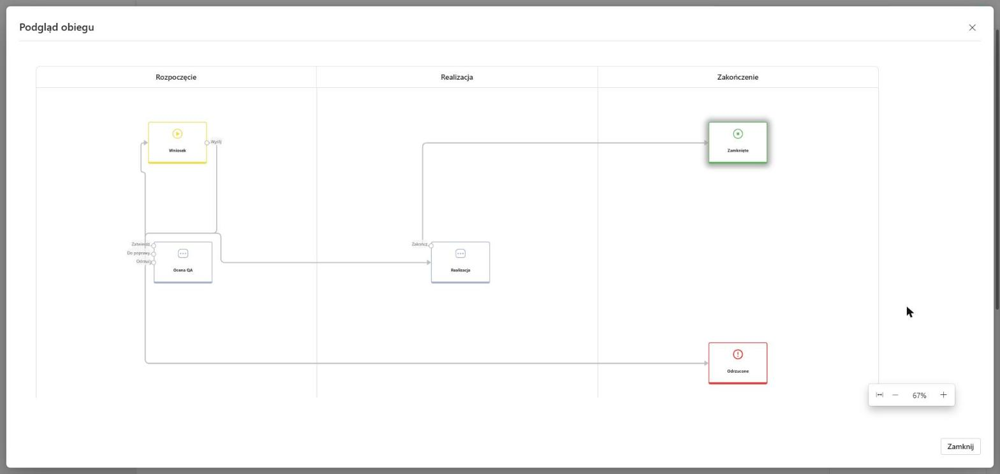
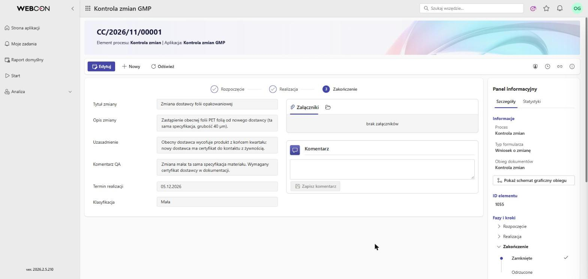
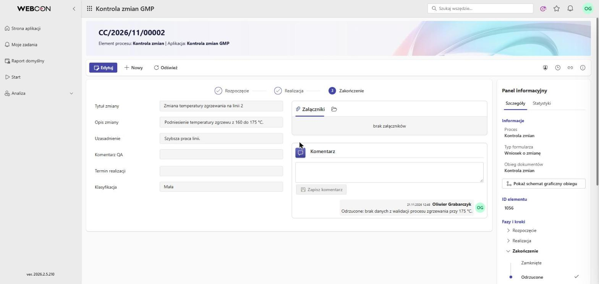
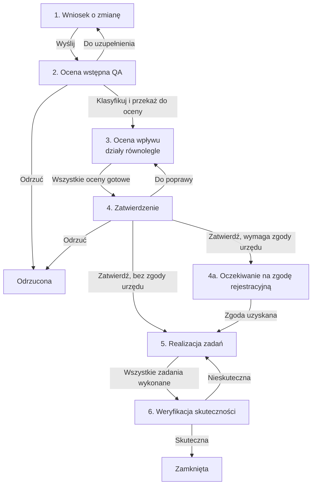

# WEBCON BPS – Kontrola zmian (change control) w zakładzie farmaceutycznym

Projekt aplikacji procesowej pod platformę low-code **WEBCON BPS**: obsługa planowanej zmiany w wytwórni leków, np. nowego dostawcy opakowania, zmiany parametru procesu, aktualizacji procedury (SOP) czy wymiany urządzenia. Zasada jest prosta: żadna zmiana mogąca wpłynąć na GMP nie jest wdrażana bez udokumentowanej oceny jej wpływu i formalnego zatwierdzenia ([Lab Manager](https://www.labmanager.com/managing-change-control-in-gmp-bioprocessing-labs-35463)).

Obieg prowadzi wniosek przez klasyfikację, ocenę wpływu kilku działów naraz (produkcja, kontrola jakości, walidacja, sprawy rejestracyjne), zatwierdzenie, realizację zadań i sprawdzenie skuteczności. Projekt łączy się z repozytorium [`webcon-odchylenia-capa-gmp`](https://github.com/olivex333/webcon-odchylenia-capa-gmp): działanie CAPA, które wymaga zmiany procesu lub dokumentu, otwiera wniosek o zmianę.

> **Status projektu.** Etap 1 jest zbudowany i przetestowany w WEBCON BPS 2026.2 (środowisko trial): uproszczony obieg z 5 krokami, opisany niżej, ze zrzutami ekranu. Pełny projekt (7 kroków, równoległa ocena wpływu, zgoda rejestracyjna) jest opisany w dokumentacji i skryptach T-SQL jako kolejne etapy. Projekt nie jest systemem zwalidowanym.

## Etap 1: zbudowane w WEBCON BPS

Aplikacja **Kontrola zmian GMP**, proces **Kontrola zmian**, formularz **Wniosek o zmianę** z sygnaturą `CC/{rok}/{miesiąc}/{numer}`.

| Krok | Typ | Ścieżki | Pola na formularzu |
| --- | --- | --- | --- |
| Wniosek | start | Wyślij → Ocena QA | Tytuł zmiany, Opis zmiany, Uzasadnienie: wymagane; pola QA ukryte |
| Ocena QA | pośredni | Zatwierdź → Realizacja, Do poprawy → Wniosek (do autora), Odrzuć → Odrzucone | pola wniosku tylko do odczytu; Klasyfikacja (Mała / Duża) i Termin realizacji wymagane; Komentarz QA |
| Realizacja | pośredni | Zakończ → Zamknięte | wszystko tylko do odczytu |
| Zamknięte | końcowy pozytywny | – | tylko do odczytu |
| Odrzucone | końcowy negatywny | – | tylko do odczytu |

- **Klasyfikacja** to pole wyboru ze źródłem danych „Klasy zmian” (stała lista wartości: `MALA` / Mała, `DUZA` / Duża).
- Ścieżki **Odrzuć** i **Do poprawy** wymagają komentarza i nie wymuszają wypełnienia pól oceny, bo przy odrzuceniu termin realizacji nie ma sensu.

**Przetestowane scenariusze:**

1. Wniosek „Zmiana dostawcy folii opakowaniowej” → Wyślij → Zatwierdź (Mała, termin 05.12.2026) → Zakończ. Wynik: `CC/2026/11/00001` w kroku Zamknięte.
2. Wniosek „Zmiana temperatury zgrzewania na linii 2” → Wyślij → Odrzuć bez komentarza. Wynik: błąd „Komentarz jest wymagany na ścieżce: Odrzuć”. Po dopisaniu komentarza → Odrzuć: `CC/2026/11/00002` w kroku Odrzucone.

## Zawartość

| Plik | Co zawiera |
| --- | --- |
| [`docs/obieg.md`](docs/obieg.md) | diagram obiegu, kroki, ścieżki, zadania równoległe, uprawnienia |
| [`docs/ocena_projektu.md`](docs/ocena_projektu.md) | co ma sens, ograniczenia, co dalej |
| [`sql/01_slowniki.sql`](sql/01_slowniki.sql) | typy zmian, działy oceniające |
| [`sql/02_rejestr_i_audit.sql`](sql/02_rejestr_i_audit.sql) | rejestr zmian, oceny wpływu, zadania, ślad audytowy, reguły w ograniczeniach |
| [`sql/03_dane_testowe.sql`](sql/03_dane_testowe.sql) | fikcyjne dane testowe |
| [`sql/04_raporty.sql`](sql/04_raporty.sql) | raporty: otwarte zmiany, oceny wpływu po terminie, zadania po terminie, czas obsługi |
| [`templates/karta_zmiany.html`](templates/karta_zmiany.html) | wydruk karty zmiany (HTML/CSS) |
| [`tests/scenariusze_testowe.md`](tests/scenariusze_testowe.md) | 14 scenariuszy testowych |
| [`docs/ai_w_projekcie.md`](docs/ai_w_projekcie.md) | jak używam AI i jak weryfikuję jego wyniki |

## Role

| Rola | Kto | Co robi |
| --- | --- | --- |
| Inicjator | dowolny dział | opisuje stan obecny, proponowaną zmianę i jej powód |
| QA – specjalista | dział zapewnienia jakości | ocena wstępna, klasyfikacja, wybór działów do oceny wpływu |
| Oceniający | produkcja, kontrola jakości (QC), walidacja, sprawy rejestracyjne | ocena wpływu w swoim obszarze, lista wymaganych zadań |
| Kierownik QA | kierownik zapewnienia jakości | zatwierdza zmianę; przy zmianach krytycznych razem z dyrektorem zakładu |
| Właściciele zadań | różne działy | realizują zadania: aktualizacja SOP, szkolenia, rewalidacja, zgłoszenie do urzędu |

## Obieg

## Klasyfikacja zmian

Klasyfikacja zależy od wpływu na jakość produktu i bezpieczeństwo pacjenta, na stan zwalidowany procesów i urządzeń oraz na dokumentację rejestracyjną ([GMP Insiders](https://gmpinsiders.com/?p=9410)). W projekcie:

| Klasa | Przykład | Kto zatwierdza | Ocena wpływu |
| --- | --- | --- | --- |
| Mniejsza | wymiana drukarki etykiet na ten sam model, korekta literówki w SOP | kierownik QA | QA + dział, którego dotyczy |
| Poważna | nowy dostawca opakowania bezpośredniego, nowy wzór etykiety | kierownik QA | produkcja, QC, walidacja, sprawy rejestracyjne |
| Krytyczna | zmiana parametru krytycznego procesu wytwarzania | kierownik QA i dyrektor zakładu | wszystkie działy + analiza ryzyka |

## Formularz

| Pole | Typ pola w WEBCON | Krok |
| --- | --- | --- |
| Numer zmiany | sygnatura `CC/{rok}/{numer}` | auto |
| Typ zmiany | wybór (źródło SQL): materiał, proces, urządzenie, dokument, system komputerowy | 1 |
| Stan obecny, proponowana zmiana, uzasadnienie | tekst wielowierszowy | 1 |
| Produkty i linie, których dotyczy | lista pozycji | 1 |
| Powiązane odchylenie / CAPA | tekst lub wybór (numer DEV) | 1 |
| Klasyfikacja | wybór: mniejsza / poważna / krytyczna | 2 |
| Działy do oceny wpływu | wybór wielokrotny | 2 |
| Ocena wpływu | zadanie dla każdego działu: wpływ tak/nie, opis, wymagane zadania | 3 |
| Wymaga zgłoszenia do urzędu | tak / nie | 3 (sprawy rejestracyjne) |
| Status zgody rejestracyjnej | nie dotyczy / oczekuje / uzyskana | 4a |
| Zadania wdrożeniowe | lista pozycji: zadanie, właściciel, termin, status | 3–5 |
| Kryterium i wynik weryfikacji skuteczności | tekst | 4, 6 |

## Reguły biznesowe

1. **Nic przed zatwierdzeniem:** krok „Realizacja zadań” jest niedostępny bez daty zatwierdzenia (w bazie wymusza to ograniczenie `CK_RealizacjaPoZatwierdzeniu`).
2. **Zgoda urzędu przed wdrożeniem:** jeśli zmiana wymaga zgłoszenia do urzędu, realizacja rusza dopiero po statusie „uzyskana”.
3. **Ocena wpływu kompletna:** przejście do zatwierdzenia dopiero, gdy wszystkie wybrane działy złożyły ocenę.
4. **Zatwierdzenie zależne od klasy:** zmiana krytyczna wymaga drugiego zatwierdzającego (dyrektor zakładu).
5. **Termin oceny wpływu:** 10 dni roboczych od klasyfikacji; przypomnienia 2 dni przed terminem i po jego przekroczeniu.
6. **Zamknięcie po zadaniach:** weryfikacja skuteczności dopiero, gdy wszystkie zadania wdrożeniowe są wykonane.

## Raporty

- Otwarte zmiany według klasy i kroku
- Oceny wpływu po terminie: który dział blokuje zmianę
- Zadania wdrożeniowe po terminie
- Średni czas od wniosku do zamknięcia według klasy
- Odsetek zmian wymagających zgłoszenia do urzędu

## Konfiguracja w WEBCON BPS: kolejne etapy

- [x] Etap 1: aplikacja, proces, formularz, 5 kroków, 5 ścieżek, pola wymagane, test dwóch scenariuszy, zrzuty ekranu

- [ ] Skrypty `sql/01`–`03` na bazie pomocniczej, źródło danych w WEBCON
- [ ] Aplikacja, proces i obieg z `docs/obieg.md`, w tym zadania równoległe oceny wpływu
- [ ] Pola, listy pozycji, reguły 1–6, uprawnienia i powiadomienia
- [ ] Raporty w Portalu na podstawie `sql/04_raporty.sql`
- [ ] Pozostałe scenariusze z `tests/scenariusze_testowe.md`

## Technologie

WEBCON BPS 2026.2 (Designer Studio, Portal) · T-SQL (Microsoft SQL Server) · HTML/CSS · Mermaid · narzędzia AI do przeglądu, testów i dokumentacji

## Autor

Oliwier Grabarczyk – [github.com/olivex333](https://github.com/olivex333)
